# Quarto

According to the [Quarto Website](https://quarto.org/){target="_blank"}, *Quarto is an open-source scientific and technical publishing system*. It comes bundled with recent versions of RStudio (2022.07 or later), so it's already available on your machines.

Quarto is part of a broader ecosystem of tools that support reproducible research. Platforms like [GitHub](https://github.com/){target="_blank"}, [Jupyter](https://jupyter.org/){target="_blank"}, [Docker](https://www.docker.com/){target="_blank"}, [ArXiv](https://arxiv.org/){target="_blank"}, and [bioRxiv](https://www.biorxiv.org/){target="_blank"} can facilitate reproducibility in various ways. In this module, we won't explore the paradigm of [reproducible research](https://esajournals.onlinelibrary.wiley.com/doi/full/10.1002/bes2.1801){target="_blank"} in detail. Instead, we’ll focus on how to use Quarto to make your analyses and reports more **appealing**, **interactive**, and **efficient**.

In this lesson, we’ll weave code and narrative into professionally rendered Quarto documents and use [GitHub](https://github.com/){target="_blank"} to safely store, share, and administer our results.    

## Set up your work environment

Before creating your first Quarto document, we need to set up your **GitHub environment**.

Originally designed for software development, GitHub is also a powerful tool for managing changes in documents and data projects. Its version control system helps track edits, collaborate with others, and maintain a clear history of your work.

Even if you're working solo, GitHub offers valuable features like change tracking, documentation, and easy sharing.

To set up your personal GitHub environment, follow these steps:

1) Review the [Hello-World Section](https://docs.github.com/en/get-started/quickstart/hello-world){target="_blank"} in GitHub's Quickstart Documentation. Initially, reading it is sufficient—no need to complete the tutorial yet.
2) [Create a GitHub account](https://github.com/){target="_blank"}.
3) [Download and install Git](https://git-scm.com/downloads){target="_blank"}. Git is a distributed **VCS (version control system)** that stores your project history locally and remotely. GitHub is a web-based interface that works seamlessly with Git. For a quick intro to Git’s core concepts, watch this [video](https://www.youtube.com/watch?v=uR6G2v_WsRA){target="_blank"}.
4) In RStudio (under Tools > Global Options > Git / SVN), check "enable version control" and set the path to `git`. On Windows: `C:\Program Files\Git\bin\git.exe`. On macOS/Linux, the path is usually set automatically (e.g., `/usr/bin/git` or `/opt/homebrew/bin/git` if installed via Homebrew). After setting the path, restart RStudio.
5) [Create a repository](https://docs.github.com/en/get-started/quickstart/create-a-repo){target="_blank"} on GitHub. You can skip the “Commit your first changes” section for now.
6) By default, your repository will have one branch named `main`. Create an additional branch called `dev` off the `main`. Follow the instructions in the [Hello-World Tutorial](https://docs.github.com/en/get-started/quickstart/hello-world){target="_blank"} for guidance.

::: callout-note

For technical issues, please consult the discussion forum.

:::

### Tell Git who you are (one-time setup)

Before making your first commit, configure Git with your name and email. These values are stored locally and will be attached to each commit you make.

In the **Terminal tab** of RStudio, run:

```bash
git config --global user.name "Jane Doe"
git config --global user.email "jane.doe@example.com"
```

To verify:

```bash
git config --global --list
```

This setup is independent of how you authenticate with GitHub (via token or SSH key).

### Authenticating with GitHub

Since 2021, GitHub no longer supports password-based authentication. You must choose one of the following secure methods:

#### Personal Access Token (HTTPS)

- Navigate to:  
  **GitHub > Settings > Developer settings > Personal access tokens > Fine-grained tokens**
- Click **Generate new token**.
- Provide a name, select the `repo` permission, set an expiry date, and copy the token.
- When RStudio prompts for a password during your first push, paste the token. Your GitHub username remains unchanged.

This method is straightforward and works reliably across most environments.

#### SSH Key

- Generate a key:

  ```bash
  ssh-keygen -t ed25519 -C "you@example.com"
  ```

  Press Enter to accept the defaults.

- Copy the contents of `~/.ssh/id_ed25519.pub` and add it to GitHub under:  
  **Settings > SSH & GPG keys > New SSH key**

SSH is well-suited for automation and scripting workflows.

#### Git Credential Manager (GCM)

- On **Windows**, GCM is bundled with Git.
- On **macOS**, install via:

  ```bash
  brew install --cask git-credential-manager
  ```

The first push will open a browser window for login. GCM stores your credentials securely in your system keychain and handles token rotation automatically.

::: callout-note

To view or clear saved credentials in RStudio:  
**Tools > Global Options > Git/SVN > Credentials**

On Windows, credentials are stored in the **Credential Manager**.  
On macOS, they’re stored in **Keychain Access**.

:::

### Switching between HTTPS and SSH

If you cloned a repository using HTTPS but later want to switch to SSH:

```bash
git remote set-url origin git@github.com:<USER>/<REPO>.git
```

To switch back to HTTPS:

```bash
git remote set-url origin https://github.com/<USER>/<REPO>.git
```

### Common Troubleshooting Checklist

| Issue | Solution |
|-------|----------|
| `Authentication failed` after token paste | Token expired or missing `repo` scope. Generate a new fine-grained PAT. |
| Prompted for credentials on every push/pull | Enable credential caching: `git config --global credential.helper manager-core` |
| `Permission denied (publickey)` with SSH | Run `ssh -T git@github.com` to test. Add key to agent: `ssh-add ~/.ssh/id_ed25519`. |
| RStudio ignores saved credentials | Upgrade to RStudio ≥ 2023.12. Older versions may not use system keychains correctly. |

For platform-specific instructions on credential caching and authentication, refer to [GitHub’s official documentation](https://docs.github.com/en/get-started/git-basics/caching-your-github-credentials-in-git){target="_blank"}.

## Create a local clone

Cloning a repository means copying its contents including version history from GitHub to your local machine. This allows you to work on the project in RStudio while maintaining version control.

To clone your repository:

1. In RStudio, navigate to:  
   **File > New Project > Version Control > Git**

2. Use the **HTTPS or SSH link** from your GitHub repository (found under the green “Code” button), depending on your chosen authentication method.

3. Select a local directory for the clone and click **Create Project**.

::: {#fig-clone}

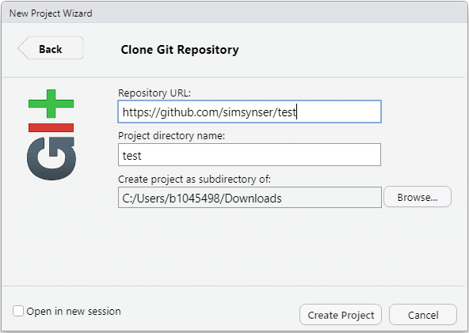{width="60%" fig-align="center"}

Clone GitHub Repository

:::

After cloning, the repository’s contents will appear in the **Files** pane, and a new **Git** tab will be visible in the RStudio interface.

::: {#fig-newinstud}

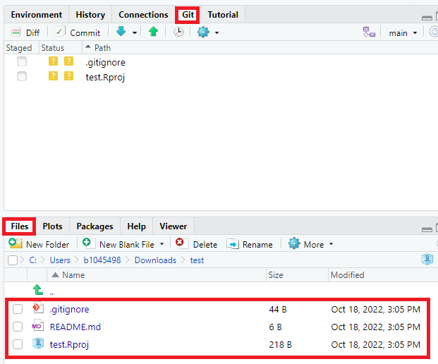{width="60%" fig-align="center"} 


New features in RStudio

:::

By default, the repository includes:

1) [`.gitignore`](https://git-scm.com/docs/gitignore){target="_blank"}: Specifies intentionally untracked files to ignore.
2) [RStudio Project File](https://support.rstudio.com/hc/en-us/articles/200526207-Using-RStudio-Projects){target="_blank"} (`.Rproj`): Contains metadata for the RStudio project.
3) [ReadMe File](https://docs.github.com/en/repositories/managing-your-repositorys-settings-and-features/customizing-your-repository/about-readmes){target="_blank"} (`.md`): A markdown file with information about the repository.

The [`gitignore`](https://git-scm.com/docs/gitignore){target="_blank"} and [`.Rproj`](https://support.rstudio.com/hc/en-us/articles/200526207-Using-RStudio-Projects){target="_blank"} files are created locally when initializing the project in RStudio. These may not yet exist on GitHub, depending on how the repository was originally set up.

::: {#fig-change}

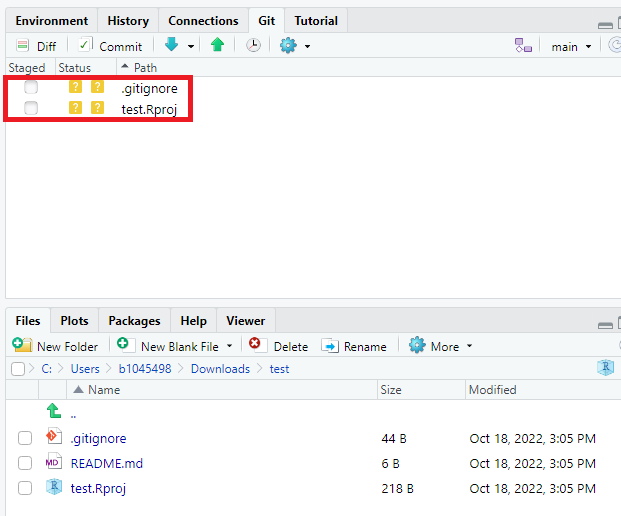{width="60%" fig-align="center"} 


Changes in Git tab

:::

Before making further changes, switch to the `dev` branch:

::: {#fig-branch}

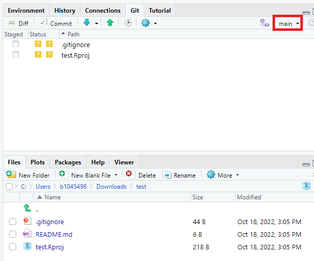{width="60%" fig-align="center"} 

Switch branch

:::

At this point, the `dev` branch mirrors the `main` branch.

::: callout-note

It is recommended to work on a separate development branch (e.g., `dev`) and reserve the `main` branch for stable versions. Changes can later be merged into `main` via a pull request. See [Opening a Pull Request](https://docs.github.com/en/get-started/quickstart/hello-world#opening-a-pull-request){target="_blank"} for details.

:::

## Creating your first Quarto document

Now that the environment is set up, let's create our first Quarto document.

In RStudio: Navigate to (File > New File > Quarto Document). Enter a title for your document, accept the default settings, click "OK", and save the file. You'll receive a sample Quarto file with the extension `.qmd`.

By default, Quarto is in [Visual Editing](https://quarto.org/docs/visual-editor/){target="_blank"} mode, which provides a [WYSIWYM-style](https://en.wikipedia.org/wiki/WYSIWYM){target="_blank"} editing interface for Quarto documents. To switch to the Source Editor:


::: {#fig-schem1}

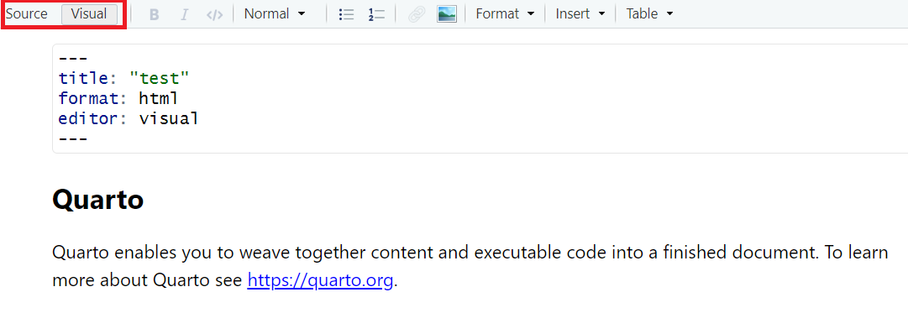{width="70%" fig-align="center"} 

Switch mode in RStudio

:::

> While the Visual Editor is intuitive and beginner-friendly, the Source Editor offers greater control and transparency. It also makes debugging and version control easier.

Quarto supports two editing modes:

| Mode | Best suited for | How to switch |
|------|----------|---------------|
| **Visual (WYSIWYM)** | Quick drafting, beginners, content-first writing | Click  “Visual" |
| **Source** | Precise Markdown control, debugging chunk options, version-control diffs | Click “Source” |

> **Recommendation:** Start in *Visual* mode if you're new to Markdown. Switch to *Source* mode when you need fine-grained control or are preparing code for review or collaboration.

Quarto documents consist of three core components: **metadata**, **text**, and **code**.

::: {#fig-schem2}

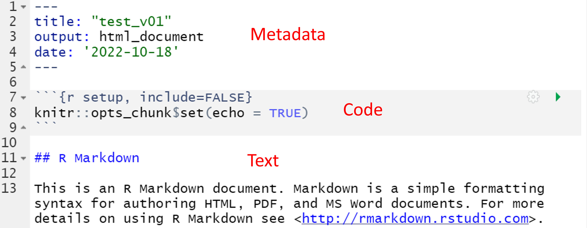{width="70%" fig-align="center"}

Quarto sample file

:::

The metadata section is written in YAML and defines properties such as the document title, output format, and creation date.

::: {.exercisebox title="Exercise"}

Explore YAML syntax and document properties [here](https://rpubs.com/drgregmartin/1266674){target="_blank"}.

Add a parameter to the metadata section of your Quarto document to include today’s date in the header. Then click **Render** in RStudio to generate the HTML output.

:::

::: {.exercisebox title="Solution" collapse="true" appearance="simple"}

```
    
---
title: "test"
format: html
editor: visual
date: today
---

```

:::

You can also change the output format using the `format` parameter. Quarto supports a wide range of formats including HTML, PDF, Word, ePub, Jupyter, and more. See the full list [here](https://quarto.org/docs/output-formats/all-formats.html){target="_blank"}. 

::: callout-note

Alternatively, YAML-configurations may be specified on a project level (separate file named `_quarto.yml`) or on a code chunk level (see [YAML Locations](https://rstudio-pubs-static.s3.amazonaws.com/1266674_7e6d2e9a96b648ffac1826f4f1787f31.html#yaml-locations){target="_blank"}).

:::

Code blocks in Quarto begin and end with three backticks. To specify an R code block, use `{r}` after the opening backticks:

```{r}
summary(cars)
```

Quarto supports multiple languages including R, Python, Julia, and Observable JS.

You can control how code behaves using execution options. For example:

- `#| echo: false` hides the code but still runs it.
- `#| eval: false` shows the code but does not execute it.

These options are useful for teaching, documentation, or drafts. A full list is available [here](https://quarto.org/docs/computations/execution-options.html){target="_blank"}.

::: {.exercisebox title="Exercise"}

Insert the following code into your Quarto document. Add explanatory text below the chart and render the document as HTML:

```{r eval=FALSE}

library(ggplot2)
ggplot(data=cars, aes(x=speed, y=dist)) +
  geom_point() +
  geom_smooth()

```

:::

This exercise demonstrates one of Quarto’s key strengths: the ability to combine narrative and code into a single, reproducible document that can be rendered in multiple formats.


### Under the hood – the render pipeline

When you click **Render**, Quarto runs a processing pipeline that converts your `.qmd` file into the final output document. This process involves three main steps:

1. **knitr** (for R) or **Jupyter** (for Python) executes the code chunks and generates an intermediate Markdown (`.md`) file. This file combines your code, output, and narrative text.

2. **pandoc** converts the Markdown file into the final output format—such as HTML, PDF, or Word—applying layout and styling.

3. The rendered document opens in the RStudio Viewer or your default browser.

```text
.qmd  -->  knitr(r)/jupyter(py) (code runs) --> .md  -->  pandoc --> HTML | PDF | Word
                                            ▲                    ▲
                                    executes R/Python   LaTeX, styling, layout
```

You can specify the desired output format in the document’s YAML front matter or in a project-level `_quarto.yml` configuration file.

Understanding this pipeline is useful for debugging. It helps you identify whether an issue originates from code execution, Markdown conversion, or final rendering.

> For more details, see the [Quarto Documentation](https://quarto.org/docs/get-started/hello/rstudio.html#how-it-works){target="_blank"}.

## Synchronizing with GitHub

Regular synchronization between your local project and the online repository is essential for version control. Begin by pulling any updates from GitHub.

In RStudio’s Git tab, click the **Pull** button:

::: {#fig-pull}

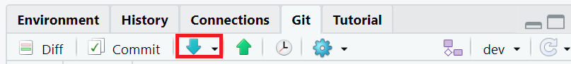{width="70%" fig-align="center"}


Make Pull

:::

Even when working alone, it's good practice to start each session with a pull to ensure your local copy is up to date.

Next, commit your changes. A commit is a snapshot of your progress, accompanied by a descriptive message.

1. Save all open files in RStudio.
2. Click the **Commit** button in the Git tab.
3. The commit window shows modified files. Green highlights indicate new content; red highlights indicate deletions. This is called a **diff view**, showing changes since your last commit.

Select the files to include, write a meaningful commit message, and click **Commit**.

Alternatively, you can use the terminal:

```bash
git add -A
git commit -m "test"
```

See @fig-commit.

::: {#fig-commit}

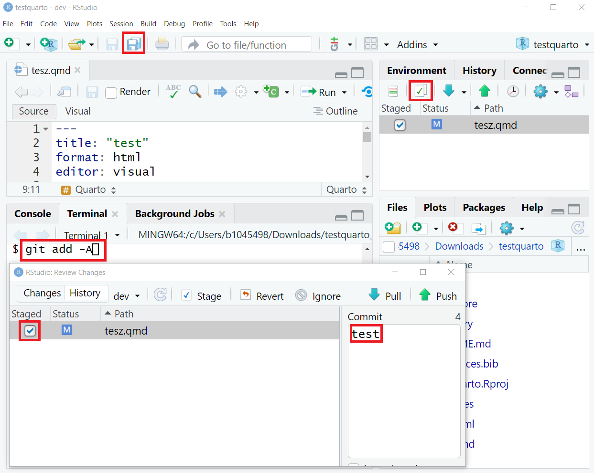{width="70%" fig-align="center"}


Make Commit

:::

Finally, push your committed changes to GitHub:

::: {#fig-push}

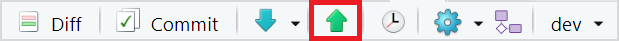{width="70%" fig-align="center"}


Make Push

:::

Your online repository should now reflect the latest changes. Make sure you're viewing the correct branch (e.g., `dev`) on GitHub.

::: {#fig-commitfin}

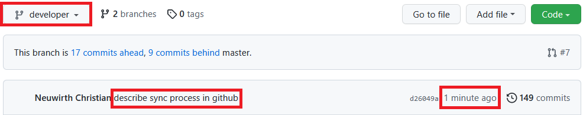{width="80%" fig-align="center"}


Commit with message 'test' was pushed to the dev branch a minute ago

:::

In this example, the `dev` branch is two commits ahead of `main`. To share your updates or integrate them into the stable version, [open a pull request](https://docs.github.com/en/get-started/quickstart/hello-world#opening-a-pull-request){target="_blank"} to merge `dev` into `main`.

## Basic markdown syntax

Quarto uses **Markdown**, a lightweight markup language, to format text. Markdown relies on plain-text symbols to control layout and styling.

### Common formatting

- **Bold**: Use double asterisks: `**Text**` → **Text**
- *Italic*: Use single asterisks: `*Text*` → *Text*
- **Headings**: Use hash signs `#` to define heading levels:

```markdown
# Heading level 1
## Heading level 2
### Heading level 3
```

### Tables

Tables are created using pipes `|` and dashes `-`. For example, the numeric operators table in the first lesson was written in Markdown. Figure @fig-mtab shows how such a table is constructed.

::: {#fig-mtab}

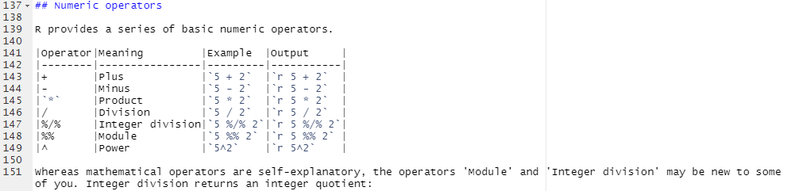{width="100%" fig-align="center"}


How Tables are made in Markdown

:::

### Lists

**Ordered lists** use numbers followed by a period:
    
    Code - Ordered List:
    1. item 1
    1. item 2
    1. Item 3
        + Item 3a
        + Item 3b

**Will result in:**

1. Item 1
2. Item 2
3. Item 3
    + Item 3a
    + Item 3b


To create an **unordered list**, use `*`, `-`, or `+`:
    
    Code - Unordered List:
    * item 1
    * item 2
      * Item 3.1
      - Item 3.2

**Which will result in:**

* Item 1
* Item 2
    + Item 2a
    - Item 2b

### Hyperlinks

Use `Text` to create links. For example:

```markdown
[GitHub](https://github.com/){target="_blank"}
```

This renders as: [GitHub](https://github.com/){target="_blank"}. The `target="_blank"` parameter opens the link in a new tab, which is a good practice when linking to external websites.

The `target="_blank"` attribute opens the link in a new tab, which is recommended for external sites.

### Blockquotes

Use `>` for blockquotes. Nesting is possible with multiple `>`:

    >"Everything is related to everything else, but near things are more related than distant things".
    >
    >>The phenomenon external to an area of interest affects what goes on inside.

**Will result in:**

>The first law of geography is: "Everything is related to everything else, but near things are more related than distant things"
>
>>The phenomenon external to an area of interest affects what goes on inside.

### Escaping special characters

Some characters have special meaning in Markdown (e.g., `#`, `*`, `>`, `$`). To display them literally, prefix with a backslash (`\`):

- `\#` → `#`
- `\*` → `*`


### Mathematical notation

Quarto supports LaTeX-style math using dollar signs: 

**Math. notation example 1:**

`$x = y$`

**Result looks like:**

$x = y$

**Math. notation example 2:**

`$\frac{\partial f}{\partial x}$`

**Result looks like:**

$\frac{\partial f}{\partial x}$

::: callout-note

See ["Mathematics in R Markdown"](https://rpruim.github.io/s341/S19/from-class/MathinRmd.html){target="_blank"} as well as [Markdown Basics](https://quarto.org/docs/authoring/markdown-basics.html){target="_blank"} for more.

:::

### References in Quarto

Quarto supports citation management and automatic bibliography generation using a `.bib` file, which stores reference metadata in BibTeX format.

#### Create a `.bib` File

Create a plain-text file using any editor (e.g., Notepad, VS Code, or RStudio) and save it with a `.bib` extension (e.g., `references.bib`) in your project folder.

#### Enable BibTeX export in Google Scholar

To export references from Google Scholar, enable BibTeX export in your settings:

::: {#fig-scholar1}

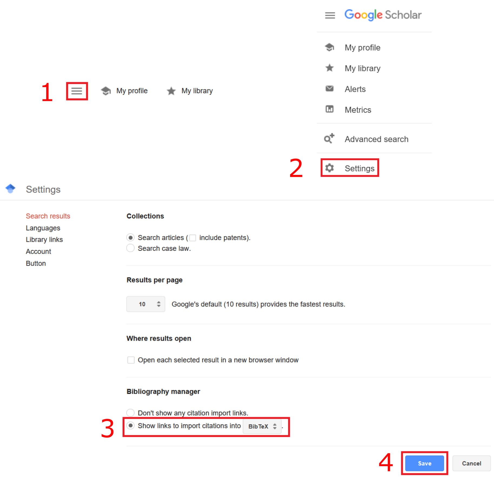{width="70%" fig-align="center"}


Enable BibTeX in Firefox 106.0.1

:::

> Browser interfaces may vary. Refer to the course discussion forum if you encounter issues.

#### Export BibTeX entries

Once BibTeX export is enabled, a new link labeled **"Import into BibTeX"** will appear below each reference:

::: {#fig-scholar2}

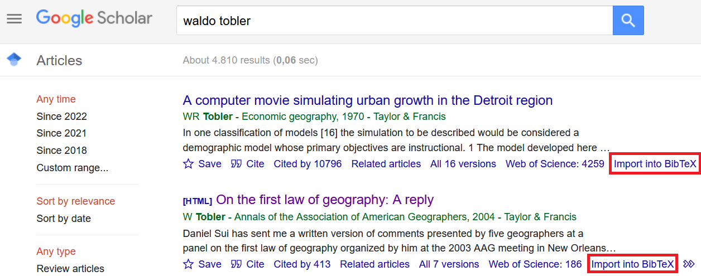{width="80%" fig-align="center"}

BibTeX Link in Firefox 106.0.1

:::

Click the link and copy the BibTeX entry into your `.bib` file.

#### Integrate references in Quarto

To cite references in your Quarto document:

1. Specify the `.bib` file in the YAML metadata:

```yaml
bibliography: references.bib
```

2. Use `@<BibTeXKey>` to insert citations in your text.

::: {#fig-ref}

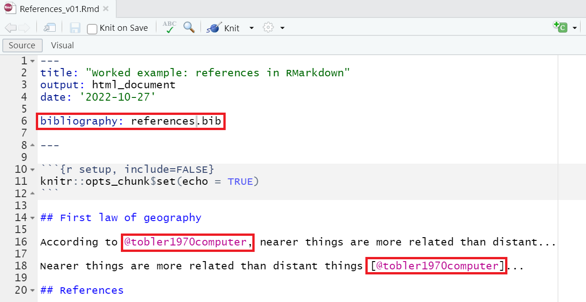{width="80%" fig-align="center"}

Integrate BibTeX reference in Quarto document

:::

#### Render the document

Render the document to HTML. Quarto will process citations and generate a bibliography automatically. Both inline (`@key`) and bracketed (`[@key]`) citation styles are supported.

::: {#fig-ref2}

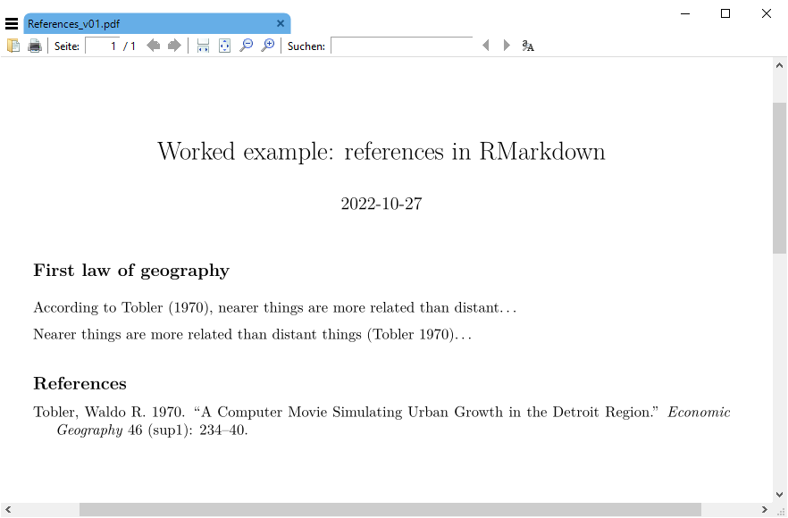{width="80%" fig-align="center"}


Quarto with reference 

:::

For a hands-on example, download this [Quarto reference example](data/testquarto.zip){target="_blank"}, unzip the folder, and open the `.Rproj` file in RStudio.


## Extending Quarto with extensions and filters

Quarto’s core is intentionally lightweight, but it can be extended with **community-built extensions** for advanced customization, automation, and enhanced interactivity.

### How It Works Under the Hood

1. Running `quarto add ...` downloads the extension into an `_extensions/` folder at the root of your project.  
   → This folder should be committed to version control so collaborators share the same behavior.

2. During rendering, **Pandoc** automatically loads any Lua filters found in `_extensions/`.

3. These filters modify the document dynamically — for example, by injecting diagrams or styling callouts.

> **Why Lua?** Pandoc’s native filter language is Lua. Lua filters run without external dependencies and offer high performance.

### Example: one-line installation

```bash
# Adds a custom callout filter. The Exercise boxes in this module use it.
quarto add coatless-quarto/custom-callout
```

A catalog of available extensions along with a short guide on writing your own is available in the [Quarto Extension Gallery](https://quarto.org/docs/extensions/){target="_blank"}.

To activate filters, list them in your `_quarto.yml` file:

```yaml
filters:
  - webr
  - custom-callout
```

Always check the extension’s README for additional setup instructions.

## Speed up your workflows

Quarto can significantly streamline repetitive reporting tasks. For example, if a client requires daily updates on spatial economic indicators, you can automate the process using Quarto. Instead of manually generating reports, Quarto can compile updated data and visualizations each time the document is rendered.

For real-time data, [Alpha Vantage](https://www.alphavantage.co/){target="_blank"} provides financial market data via its [Alpha Vantage Rest API](https://www.alphavantage.co/documentation/){target="_blank"}. The R package [`alphavantager`](https://cran.r-project.org/web/packages/alphavantager/index.html){target="_blank"} enables access to this API directly from R.

This allows you to retrieve real-time stock prices, FX rates, and technical indicators, and integrate them into Quarto reports for automated analysis and visualization.


::: callout-note

The free Alpha Vantage tier is limited to 25 API requests per day.

:::

::: {.exercisebox title="Exercise"}

Explore a practical example by downloading this [draft finance data report](data/RMarkdownFinanceData.zip){target="_blank"}. Unzip the folder and open the `.Rproj` file in RStudio.

The project includes:

- A `.bib` file with a BibTeX reference.
- A `.csv` file in the data folder, listing over 400 country names, national currencies, and currency codes.
- A `.qmd` file with inline R code that renders real-time currency exchange rates in a map.

Review the `.qmd` file thoroughly before compiling an HTML output. Note that it includes an interactive Leaflet map, making HTML the only supported output format.

Try enhancing the report with an additional spatial indicator, such as a map displaying exchange rates from national currencies to the Euro.

:::

## Self-study

Quarto’s capabilities extend far beyond what we’ve covered in this session. To explore more advanced features, consult the [Quarto Guide](https://quarto.org/docs/guide/){target="_blank"}.

Topics include:

- Cross-references and figure management
- Computations in R, Python, Julia, and Observable
- Output formats such as presentations, dashboards, websites, books, and manuscripts

::: callout-note

To find inspiration for your own projects you may consult the [Quarto Gallery](https://quarto.org/docs/gallery/){target="_blank"}, which showcases a wide range of real-world examples

:::
